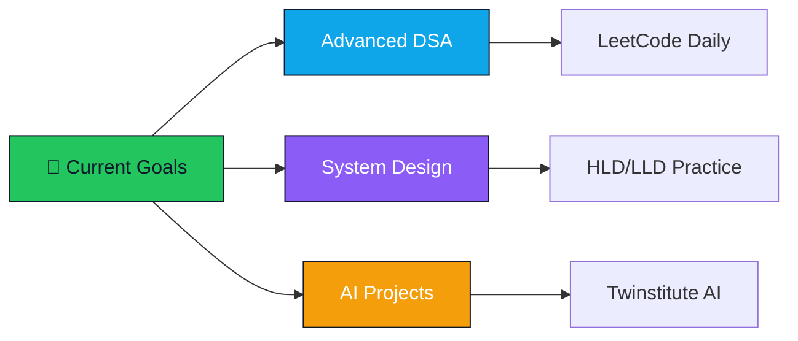

<!-- ========================================================================
   MOHAMMED QIZAR BILAL | AI SYSTEMS ENGINEER
   Premium • Animated • Interactive • Award-Worthy Profile
======================================================================== -->

<div align="center">

<!-- ✦ DESIGNER TOP BAR — VENOM GRADIENT + TWINKLE ✦ -->


<!-- ✦ DUAL TYPING ANIMATION ✦ -->


<!-- ✦ LIVE COUNTERS ✦ -->
<p>


</p>

<!-- ✦ SOCIAL DOCK ✦ -->
<p>
  <a href="mailto:bilalqizar@gmail.com">
    
  </a>
  <a href="https://www.linkedin.com/in/mohammed-qizar-bilal">
    
  </a>
  <a href="https://qizar-bilal.vercel.app">
    
  </a>
  <a href="https://github.com/QizarBilal">
    
  </a>
  <a href="https://www.x.com/QizarBilal">
    
  </a>
</p>

<!-- ✦ LOCATION & STATUS ✦ -->


<br/><br/>

<!-- ✦ BADGE NAVIGATION BAR ✦ -->
<a href="#-professional-summary"></a>
<a href="#-hiring-snapshot"></a>
<a href="#-tech-arsenal"></a>
<a href="#-featured-projects"></a>
<a href="#-professional-journey"></a>
<a href="#-lets-connect"></a>

</div>

<!-- ✦ CONTRIBUTION SNAKE ANIMATION (requires snake.yml workflow — see repo /.github/workflows) ✦ -->
<div align="center">

<picture>
  <source media="(prefers-color-scheme: dark)" srcset="https://raw.githubusercontent.com/QizarBilal/QizarBilal/output/github-contribution-grid-snake-dark.svg"/>
  <source media="(prefers-color-scheme: light)" srcset="https://raw.githubusercontent.com/QizarBilal/QizarBilal/output/github-contribution-grid-snake.svg"/>
  
</picture>

</div>

---

<!-- ✦ PROFESSIONAL SUMMARY ✦ -->
<div align="center">


## 📌 Professional Summary

</div>

<div align="center">
<table>
<tr>
<td>


Software Engineer with hands-on experience across **backend systems, full-stack web applications, and applied AI/NLP**. I design clean, modular architectures, ship production-oriented code, and focus on building products that solve real-world problems with measurable outcomes.

Experience spans internal product engineering, an AI internship through the Infosys Springboard program, and front-end development on a hackathon platform, backed by a portfolio of projects spanning AI career tooling, healthcare compliance, sustainability, and civic-tech.

<p>


</p>

</td>
</tr>
</table>
</div>

---

<!-- ANIMATED DIVIDER -->


<!-- ABOUT ME SECTION WITH GIF -->
<div align="center">

##  About Me

</div>

<div align="center">
<table>
<tr>
<td width="50%">

```typescript
const mohammed = {
  role: "Software Engineer (SDE) | Full-Stack Developer | AI Engineer",
  focus: [
    "Scalable Backend Systems",
    "Full-Stack Applications",
    "AI-Powered Products"
  ],
  approach: {
    problem: "Real-world challenges",
    architecture: "Scalable & clean systems",
    execution: "Production-ready engineering",
    impact: "Measurable results"
  },
  currentProjects: [
    "Twinstitute AI (Multi-Agent System)",
    "Advanced DSA & System Design",
    "Full-Stack + AI Products"
  ],
  philosophy: "Build systems that scale, not just features"
};
```

</td>
<td width="50%">

</td>
</tr>
</table>
</div>

---

<!-- ANIMATED DIVIDER -->


<!-- ✦ HIRING SNAPSHOT — COMPONENT-STYLE BADGE TABLE ✦ -->
<div align="center">

## 🧾 Hiring Snapshot

<table>
<tr>
<td align="center"></td>
<td>


</td>
</tr>
<tr>
<td align="center"></td>
<td></td>
</tr>
<tr>
<td align="center"></td>
<td>


</td>
</tr>
<tr>
<td align="center"></td>
<td>


</td>
</tr>
<tr>
<td align="center"></td>
<td></td>
</tr>
<tr>
<td align="center"></td>
<td></td>
</tr>
<tr>
<td align="center"></td>
<td></td>
</tr>
<tr>
<td align="center"></td>
<td>
<a href="mailto:bilalqizar@gmail.com"></a>
<a href="https://www.linkedin.com/in/mohammed-qizar-bilal"></a>
</td>
</tr>
</table>

</div>

<!-- Optional: add a resume row here, e.g. badge linking to YOUR_RESUME_LINK -->

---

<!-- ANIMATED DIVIDER -->


<!-- TECH STACK SECTION WITH CAROUSEL EFFECT -->
<div align="center">

##  Tech Arsenal

</div>

<!-- ANIMATED SKILLS SHOWCASE -->
<div align="center">

### 💻 Languages & Frameworks


### 🗄️ Databases & Tools


### ⚙️ DevOps & Infrastructure


### 🤖 AI/ML & Data Science


</div>

</br>
<!-- ADDITIONAL TECH STACK TABLE — ANIMATED SVG ICONS -->
<div align="center">
<table>
<tr>
<td align="center" width="25%">

<br><strong>Python</strong>
</td>
<td align="center" width="25%">

<br><strong>TypeScript</strong>
</td>
<td align="center" width="25%">

<br><strong>React</strong>
</td>
<td align="center" width="25%">

<br><strong>Docker</strong>
</td>
</tr>
<tr>
<td align="center" width="25%">

<br><strong>REST API</strong>
</td>
<td align="center" width="25%">

<br><strong>AWS</strong>
</td>
<td align="center" width="25%">

<br><strong>GitHub</strong>
</td>
<td align="center" width="25%">

<br><strong>Nginx</strong>
</td>
</tr>
</table>
</div>

<!-- ✦ SKILLS MATRIX — COMPONENT STYLE ✦ -->
<div align="center">

### 🧭 Skills at a Glance

<table>
<tr>
<th></th>
<th></th>
<th></th>
</tr>
<tr>
<td align="center"></td>
<td>


</td>
<td><sub>SkillMatch-AI • Zidio Portal • MediVerse Guardian X</sub></td>
</tr>
<tr>
<td align="center"></td>
<td>


</td>
<td><sub>Twinstitute AI • Zidio Portal • GreenNode</sub></td>
</tr>
<tr>
<td align="center"></td>
<td>


</td>
<td><sub>SkillMatch-AI • Twinstitute AI • ai-sahayak</sub></td>
</tr>
<tr>
<td align="center"></td>
<td>


</td>
<td><sub>Zidio Portal • Twinstitute AI</sub></td>
</tr>
<tr>
<td align="center"></td>
<td>


</td>
<td><sub>Deployment & CI workflows</sub></td>
</tr>
<tr>
<td align="center"></td>
<td>


</td>
<td><sub>Daily practice & design reviews</sub></td>
</tr>
</table>

</div>

---

<!-- ANIMATED DIVIDER -->


<!-- RECRUITER QUICK VIEW -->
<div align="center">

##  Recruiter Quick View

<table>
<tr>
<th></th>
<th></th>
<th></th>
</tr>
<tr>
<td align="center"><strong>AI Systems Architecture</strong></td>
<td align="center"><a href="https://github.com/QizarBilal/Twinstitute-AI"></a></td>
<td align="center"><sub>Multi-agent career development platform</sub></td>
</tr>
<tr>
<td align="center"><strong>NLP & Machine Learning</strong></td>
<td align="center"><a href="https://github.com/QizarBilal/SkillMatch-AI"></a></td>
<td align="center"><sub>85%+ accuracy resume intelligence</sub></td>
</tr>
<tr>
<td align="center"><strong>Full-Stack Development</strong></td>
<td align="center"><a href="https://github.com/QizarBilal/Zidio-Hackathon-Portal"></a></td>
<td align="center"><sub>Complete hackathon management ecosystem</sub></td>
</tr>
<tr>
<td align="center"><strong>Applied AI Solutions</strong></td>
<td align="center"><a href="https://github.com/QizarBilal/MediVerse-GuardianX"></a></td>
<td align="center"><sub>AI-powered prescription verification</sub></td>
</tr>
</table>

</div>

<div align="center">

### 🎖️ What Sets Me Apart

<table>
<tr>
<td align="center" width="33%">

<br><strong>Clean Architecture</strong>
<br><sub>Modular, scalable, maintainable</sub>
</td>
<td align="center" width="33%">

<br><strong>Production Focus</strong>
<br><sub>Real-world deployment ready</sub>
</td>
<td align="center" width="33%">

<br><strong>Problem Solver</strong>
<br><sub>Complex challenges, elegant solutions</sub>
</td>
</tr>
</table>

</div>

---

<!-- ANIMATED DIVIDER -->


<!-- FEATURED PROJECTS -->
<div align="center">

##  Featured Projects

<!-- ✦ PROJECT OVERVIEW — CARD-STYLE TABLE ✦ -->

### 🗂️ Project Overview

<table>
<tr>
<th></th>
<th></th>
<th></th>
<th></th>
</tr>
<tr>
<td align="center"><strong>🏗️ Twinstitute AI</strong></td>
<td><sub>Capability-engineering platform with learner digital twins, adaptive execution tasks, multi-dimensional evaluation, proof artifacts and roadmaps</sub></td>
<td align="center"><br/></td>
<td align="center"><a href="https://github.com/QizarBilal/Twinstitute-AI"></a></td>
</tr>
<tr>
<td align="center"><strong>🧠 SkillMatch-AI</strong></td>
<td><sub>AI-assisted résumé-to-role analyzer with explainable skill gaps, learning roadmaps and PDF reports</sub></td>
<td align="center"></td>
<td align="center"><a href="https://github.com/QizarBilal/SkillMatch-AI"></a> <a href="http://qizarbilal-skillmatch-ai.hf.space/"></a></td>
</tr>
<tr>
<td align="center"><strong>🎯 Zidio Hackathon Portal</strong></td>
<td><sub>Role-driven hackathon ecosystem for discovering challenges, building teams, judging projects and surfacing talent</sub></td>
<td align="center"><br/></td>
<td align="center"><a href="https://github.com/QizarBilal/Zidio-Hackathon-Portal"></a> <a href="https://zidio-hackathon.netlify.app/"></a></td>
</tr>
<tr>
<td align="center"><strong>🏥 MediVerse Guardian X</strong></td>
<td><sub>Role-based healthcare-compliance prototype for synthetic prescription review, interaction flags, audit events and dashboards</sub></td>
<td align="center"><br/></td>
<td align="center"><a href="https://github.com/QizarBilal/MediVerse-GuardianX"></a></td>
</tr>
<tr>
<td align="center"><strong>🌱 GreenNode</strong></td>
<td><sub>Sustainability-first storefront with impact-aware carts, footprint history, rewards and explainable recommendations</sub></td>
<td align="center"></td>
<td align="center"><a href="https://github.com/QizarBilal/GreenNode"></a></td>
</tr>
<tr>
<td align="center"><strong>🗣️ ai-sahayak</strong></td>
<td><sub>Multilingual, voice-first Digital Seva companion for schemes, eligibility, market data, documents, local services and official drafts</sub></td>
<td align="center"></td>
<td align="center"><a href="https://github.com/QizarBilal/ai-sahayak"></a></td>
</tr>
</table>

</div>

<br/>

<!-- PROJECT 1: TWINSTITUTE AI -->
<div align="center">

### 🏗️ Twinstitute AI


**AI-Powered Digital Institution Twin | Multi-Agent Career Development Platform**

[](https://github.com/QizarBilal/Twinstitute-AI)


</div>

<div align="center">
<table>
<tr>
<td width="50%">

**🎯 System Architecture**
```
User Request
    ↓
API Gateway
    ↓
Agent Orchestrator
    ↓
┌─────────┬─────────┬─────────┐
│ Career  │  Skill  │ Content │
│ Advisor │ Analyst │  Agent  │
└─────────┴─────────┴─────────┘
    ↓
Response Pipeline
    ↓
Structured Output
```

</td>
<td width="50%">

**📊 Key Metrics**

| Feature | Details |
|---------|---------|
| 🤖 Agents | 5+ Specialized |
| 🧩 Modules | 8+ Integrated |
| ⚡ Response | Real-time |
| 🎯 Accuracy | High-fidelity |
| 🔄 Scalability | Production-ready |

</td>
</tr>
</table>
</div>

<div align="center">

**Tech Stack:** Python • FastAPI • LangChain • OpenAI • ChromaDB • Redis

</div>

<!-- PROBLEM / SOLUTION / ROLE -->
<div align="center">
<table>
<tr>
<td width="33%" valign="top" align="center">


<sub>Learners lack a unified, personalised view of their skills, progress and next steps.</sub>

</td>
<td width="33%" valign="top" align="center">


<sub>Learner digital twins with adaptive tasks, multi-dimensional evaluation, proof artifacts and generated roadmaps.</sub>

</td>
<td width="33%" valign="top" align="center">


<sub>End-to-end design and development: architecture, agent orchestration, APIs and UI.</sub>

</td>
</tr>
</table>
</div>

---

<!-- PROJECT 2: SKILLMATCH AI -->
<div align="center">

### 🧠 SkillMatch-AI
  
  
  
**Resume Intelligence System | NLP-Powered Job Matching**

[](https://github.com/QizarBilal/SkillMatch-AI)
[](http://qizarbilal-skillmatch-ai.hf.space/)

</div>

<div align="center">
<table>
<tr>
<td width="60%">

**🔍 System Capabilities**

- ✅ **Advanced NLP Parsing**: Extract skills, experience, education
- ✅ **Intelligent Matching**: 85%+ accuracy job-role alignment
- ✅ **Real-time Processing**: <2s response time
- ✅ **Multi-format Support**: PDF, DOCX, TXT
- ✅ **Skill Gap Analysis**: Automated recommendations
- ✅ **RESTful API**: Production-ready endpoints

</td>
<td width="40%">

**📈 Performance**

```python
{
  "parsing_accuracy": "92%",
  "match_precision": "85%+",
  "response_time": "<2s",
  "supported_formats": 3,
  "api_uptime": "99.5%"
}
```

</td>
</tr>
</table>
</div>

<div align="center">

**Tech Stack:** Python • Flask • spaCy • NLTK • scikit-learn • HuggingFace

> 🏢 Developed during the **Infosys Springboard AI Internship** &nbsp;|&nbsp; Hosted under the [Infosys-SkillMatch-AI](https://github.com/Infosys-SkillMatch-AI) organization

</div>

---

<!-- PROJECT 3: ZIDIO PORTAL -->
<div align="center">

### 🎯 Zidio Hackathon Portal
  
  
  
**Enterprise Hackathon Management Platform | Full-Stack Solution**

[](https://github.com/QizarBilal/Zidio-Hackathon-Portal)
[](https://zidio-hackathon.netlify.app/)

<table>
<tr>
<th></th>
<th></th>
<th></th>
<th></th>
</tr>
<tr>
<td align="center">
<br/>
<br/>

</td>
<td align="center">
<br/>
<br/>

</td>
<td align="center">
<br/>
<br/>

</td>
<td align="center">
<br/>
<br/>

</td>
</tr>
</table>

**Features:** Team Management • Real-time Leaderboards • Submission Portal • Admin Dashboard • Analytics

</div>

---

<!-- PROJECT 4 & 5 -->
<div align="center">

### 🏥 MediVerse Guardian X | 🌱 GreenNode

<table>
<tr>
<td width="50%">

**MediVerse Guardian X**


AI-powered prescription verification system

[](https://github.com/QizarBilal/MediVerse-GuardianX)

🔍 OCR • 🤖 AI Validation • ⚕️ Medical NLP

</td>
<td width="50%">

**GreenNode**


Sustainability tracking platform

[](https://github.com/QizarBilal/GreenNode)

🌍 Carbon Tracking • 📊 Analytics • 🌿 Impact Metrics

</td>
</tr>
</table>

</div>

<!-- PROJECT 6: AI-SAHAYAK -->
<div align="center">

### 🗣️ ai-sahayak

**Multilingual, Voice-First Digital Seva Companion**

Helps citizens navigate government schemes, eligibility, market data, documents, local services and official drafts.

[](https://github.com/QizarBilal/ai-sahayak)


🌐 Multilingual • 🎙️ Voice-First • 🏛️ Civic-Tech

</div>

---

<!-- ANIMATED DIVIDER -->


<!-- GITHUB STATS -->
<div align="center">

##  GitHub Analytics

</div>

<div align="center">
<table>
<tr>
<td width="50%">

</td>
<td width="50%">

</td>
</tr>
</table>
</div>

<!-- ✦ PROFILE SUMMARY CARDS — DASHBOARD LOOK ✦ -->
<div align="center">

<br/>


</div>

<!-- CONTRIBUTION GRAPH -->
<div align="center">

</div>

<!-- ACTIVITY GRAPH -->
<div align="center">

</div>

<!-- TROPHIES -->
<div align="center">

</div>

<!-- GITHUB MILESTONES -->
<div align="center">

### 🏅 GitHub Achievements

<a href="https://github.com/QizarBilal?tab=achievements">


</a>

<sub>Pull Shark • Pair Extraordinaire • Quickdraw • YOLO — earned through merged pull requests and collaborative commits</sub>

</div>

---

<!-- ANIMATED DIVIDER -->


<!-- EXPERIENCE SECTION -->
<div align="center">

##  Professional Journey

</div>

<div align="center">
<table>
<tr>
<td width="33%">

###  Webill India


```yaml
achievements:
  - Scalable internal systems
  - REST API architecture
  - System reliability ↑
  - Backend optimization
```

</td>
<td width="33%">

###  Infosys


```yaml
achievements:
  - Built SkillMatch-AI
  - NLP pipeline design
  - ML workflow automation
  - Production deployment
```

</td>
<td width="33%">

###  Zidio Dev


```yaml
achievements:
  - React components
  - Performance tuning
  - State management
  - UI/UX optimization
```

</td>
</tr>
</table>
</div>

<!-- CORE COMPETENCIES -->
<div align="center">

### 🧩 What I Bring to a Team

<table>
<tr>
<th></th>
<th></th>
</tr>
<tr>
<td align="center"></td>
<td><sub>Take features from requirements and design through deployment and iteration</sub></td>
</tr>
<tr>
<td align="center"></td>
<td><sub>Design REST APIs, data models and services built for reliability and growth</sub></td>
</tr>
<tr>
<td align="center"></td>
<td><sub>Turn NLP/LLM capabilities into usable, explainable product features</sub></td>
</tr>
<tr>
<td align="center"></td>
<td><sub>Pair programming, pull-request workflows and clear technical communication</sub></td>
</tr>
<tr>
<td align="center"></td>
<td><sub>Daily DSA and system-design practice while shipping across new stacks</sub></td>
</tr>
</table>

</div>

---

<!-- EDUCATION & RECOGNITION -->
<div align="center">

## 🎓 Education & Recognition

<table>
<tr>
<td align="center"></td>
<td></td>
</tr>
<tr>
<td align="center"></td>
<td></td>
</tr>
<tr>
<td align="center"></td>
<td><a href="https://github.com/Infosys-SkillMatch-AI"></a></td>
</tr>
<tr>
<td align="center"></td>
<td></td>
</tr>
</table>

</div>

<!-- Optional: add certifications / college name / graduation year rows here -->

---

<!-- ANIMATED DIVIDER -->


<!-- ENGINEERING PHILOSOPHY -->
<div align="center">

## 🧠 Engineering Philosophy

</div>

<div align="center">
<table>
<tr>

<td align="center" width="25%">

<br><br>
<strong>Modular Design</strong>
<br><sub>Separation of concerns • Reusable components</sub>
</td>

<td align="center" width="25%">

<br><br>
<strong>Scalable Architecture</strong>
<br><sub>Designed for growth • Distributed systems</sub>
</td>

<td align="center" width="25%">

<br><br>
<strong>Performance First</strong>
<br><sub>Low latency • Efficient resource usage</sub>
</td>

<td align="center" width="25%">

<br><br>
<strong>Production Ready</strong>
<br><sub>Reliable • Tested • Deployment-focused</sub>
</td>

</tr>
</table>
</div>

<!-- HOW I WORK -->
<div align="center">

### 🔧 How I Work

<table>
<tr>
<th></th>
<th></th>
</tr>
<tr>
<td align="center"></td>
<td><sub>Define requirements, data models and API contracts before writing code</sub></td>
</tr>
<tr>
<td align="center"></td>
<td><sub>Readable, well-structured and documented, optimised for the next maintainer</sub></td>
</tr>
<tr>
<td align="center"></td>
<td><sub>Feature branches, descriptive commits and pull-request reviews</sub></td>
</tr>
<tr>
<td align="center"></td>
<td><sub>Validation, error handling and testing built in, not added later</sub></td>
</tr>
<tr>
<td align="center"></td>
<td><sub>Containerised, repeatable deployments with CI/CD workflows</sub></td>
</tr>
</table>

</div>

---

<!-- ANIMATED DIVIDER -->


<!-- CURRENT FOCUS -->
<div align="center">

##  Current Focus

</div>

<div align="center">



</div>

<div align="center">
<table>
<tr>
<td align="center" width="33%">

<br><strong>🧠 DSA Mastery</strong>
<br><sub>Daily practice & problem solving</sub>
</td>
<td align="center" width="33%">

<br><strong>🏗️ System Design</strong>
<br><sub>HLD & LLD fundamentals</sub>
</td>
<td align="center" width="33%">

<br><strong>🚀 AI Innovation</strong>
<br><sub>Building production systems</sub>
</td>
</tr>
</table>
</div>

<!-- ✦ DEV QUOTE CARD ✦ -->
<div align="center">

</div>

---

<!-- ANIMATED DIVIDER -->


<!-- CONNECT SECTION -->
<div align="center">

##  Let's Connect


### Open to Software Engineering Opportunities

<p>
<a href="mailto:bilalqizar@gmail.com">

</a>
<a href="https://www.linkedin.com/in/mohammed-qizar-bilal">

</a>
<a href="https://qizar-bilal.vercel.app">

</a>
</p>

<!-- CONTACT DOCK -->
<table>
<tr>
<th></th>
<th></th>
<th></th>
<th></th>
</tr>
<tr>
<td align="center"><a href="mailto:bilalqizar@gmail.com"><sub>bilalqizar@gmail.com</sub></a></td>
<td align="center"><a href="https://www.linkedin.com/in/mohammed-qizar-bilal"><sub>mohammed-qizar-bilal</sub></a></td>
<td align="center"><a href="https://qizar-bilal.vercel.app"><sub>qizar-bilal.vercel.app</sub></a></td>
<td align="center"><a href="https://www.x.com/QizarBilal"><sub>@QizarBilal</sub></a></td>
</tr>
</table>

### 📝 For Recruiters

```diff
+ Review flagship projects (Twinstitute AI, SkillMatch-AI)
+ Assess system design and architecture depth
+ Evaluate production-ready code quality
+ Consider real-world problem-solving approach

! I build systems that solve real problems, not just demonstrate features
```

<!-- RECRUITER CHECKLIST -->
**⏱️ 2-Minute Review Path**

<table>
<tr>
<th></th>
<th></th>
<th></th>
</tr>
<tr>
<td align="center"></td>
<td><a href="#-hiring-snapshot"><sub><b>Hiring Snapshot</b></sub></a></td>
<td><sub>Roles, stack and availability at a glance</sub></td>
</tr>
<tr>
<td align="center"></td>
<td><a href="#️-project-overview"><sub><b>Project Overview</b></sub></a></td>
<td><sub>Six projects with live demos and source</sub></td>
</tr>
<tr>
<td align="center"></td>
<td><a href="#-professional-journey"><sub><b>Professional Journey</b></sub></a></td>
<td><sub>Industry, internship and team experience</sub></td>
</tr>
<tr>
<td align="center"></td>
<td><a href="https://qizar-bilal.vercel.app"><sub><b>Portfolio</b></sub></a></td>
<td><sub>Detailed case studies and background</sub></td>
</tr>
</table>

</div>

---

<!-- ANIMATED FOOTER -->
<div align="center">

### ⭐ Star this profile if you found it impressive!


</div>

<!-- FINAL QUOTE -->
<div align="center">

> *"Building scalable systems that solve real-world problems"*

<sub>Made with ❤️ and lots of ☕</sub>

</div>
